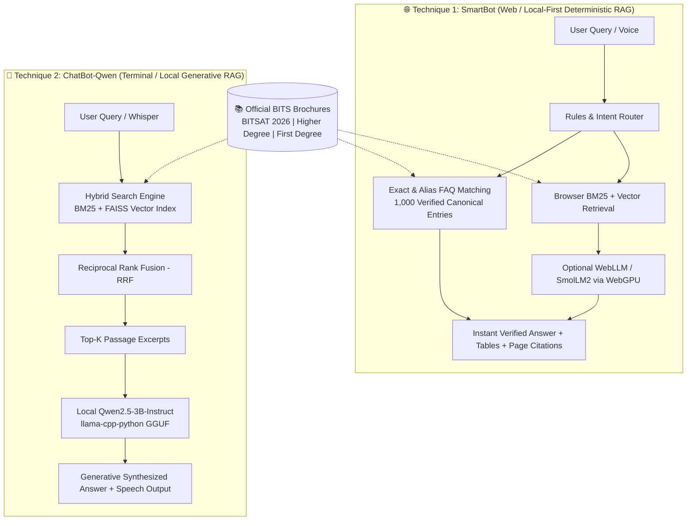

# 🎓 BITS Admissions ChatBot & Retrieval System

> **High-performance, dual-architecture admission assistant for BITS Pilani official brochures.**  
> 🌐 **Live Web App:** [chat-bot-folio.vercel.app](https://chat-bot-folio.vercel.app/)

---

## 📁 Repository Overview

The repository is organized into four modular directories:

```text
ChatBot/
├── 🌐 Frontend/       # React 18 + Vite web app (WebLLM, Web Speech, Glassmorphism UI)
├── ⚙️ Backend/        # Node.js API (Groq/Gemini provider fallback & PDF indexing tools)
├── 🧠 SmartBot/       # Canonical 1,000 FAQ dataset, deterministic retrieval, Vitest benchmarks
└── 🤖 ChatBot-Qwen/   # Standalone offline Python CLI assistant (Qwen-2.5, FAISS, Whisper)
```

---

## ⚔️ Dual-Technique Architecture: Comparison

This project implements **two complementary AI techniques** built from the same official BITS brochures (`BITSAT-2026`, `HD_Brochure_2025_26`, and `Admission_Modality_FD`):



### Detailed Feature & Matrix Comparison

| Feature / Dimension | 🌐 Technique 1: Web SmartBot | 🤖 Technique 2: Offline ChatBot-Qwen |
| :--- | :--- | :--- |
| **Primary Interface** | Modern Responsive Web UI (React + Vite) | Terminal / Interactive Python CLI |
| **Execution Environment** | Client-side Browser (Zero external API required) | Air-gapped Local Workstation (CPU / CUDA) |
| **Primary Stack** | TypeScript, React 18, Web Workers, WebGPU | Python 3.10+, PyMuPDF, FAISS, llama-cpp-python |
| **Retrieval Strategy** | 2-Tier: Canonical FAQ Match (1,000 Q&As) ➔ BM25/Vector | Hybrid: BM25 + Dense Vectors merged with RRF |
| **Answer Generation** | Deterministic Ground Truth + WebLLM (`SmolLM2`) | Generative Synthesis via `Qwen2.5-3B-Instruct-Q4_K_M` |
| **Hallucination Risk** | **0.0%** (Strict ground truth, citations & verified tables) | Minimal (Constrained evidence-only prompt) |
| **Voice Support** | Browser Web Speech API (`en-IN` & `hi-IN` with auto-send) | Local `faster-whisper` (STT) + Windows `pyttsx3` (TTS) |
| **Benchmark Accuracy** | **100% (100/100)** on held-out test queries | Evaluated across Top-3/Top-5 retrieval hit rate |
| **Best Used For** | Instant student self-service, web deployment, mobile | Deep offline research, air-gapped terminal setups |

---

## 🔍 Core Features by Technique

### 1. 🌐 SmartBot (Web / Local-First)
- **Zero-Latency FAQ Match:** Instant answers for 1,000 verified admission questions.
- **Section & Table Expansion:** Extracts and renders raw HTML tables (fees, dates, eligibility).
- **Ambiguity Clarification:** Detects underspecified queries and displays interactive programme selection chips.
- **Client-Side Privacy:** All search, indexing, and optional WebLLM inference execute inside the user's browser.

### 2. 🤖 ChatBot-Qwen (Python CLI)
- **Dense + Sparse Hybrid Search:** Fuses BM25 keyword matching with FAISS embeddings via Reciprocal Rank Fusion.
- **Local GGUF LLM:** Runs quantized `Qwen2.5-3B-Instruct` locally with CPU multi-threading or GPU offloading.
- **Full Offline Voice Loop:** Local audio recording transcribed with Faster-Whisper and spoken via SAPI TTS.
- **Interactive Slash Commands:** `/sources`, `/history`, `/clear`, `/status`, `/voice`, `/tts on/off`.

---

## ⚡ Quick Start

### 🌐 Running the Web Application (Frontend + SmartBot)

```bash
# 1. Navigate to Frontend and install dependencies
cd Frontend
npm install

# 2. Run local development server
npm run dev

# 3. (Optional) Run retrieval benchmark tests
npm run test:retrieval
```

### 🤖 Running the Offline Assistant (ChatBot-Qwen)

```powershell
# 1. Navigate to ChatBot-Qwen and create virtual environment
cd ChatBot-Qwen
python -m venv .venv
.\.venv\Scripts\Activate.ps1

# 2. Install dependencies & llama-cpp-python
pip install -r requirements.txt
pip install llama-cpp-python huggingface_hub

# 3. Build index & run
python scripts\build_index.py
python run.py
```

---

## 📊 Verification & Evaluation

- **Held-Out Paraphrases:** 80/80 (100.0%) Top-1 accuracy
- **Broad Ambiguous Queries:** 10/10 (100.0%) proper clarification triggering
- **Out-of-Domain Inquiries:** 10/10 (100.0%) correct rejection without false matches
- **Total Test Score:** **100.0% (100/100)** with **0.0% false-match rate**

---

## 📄 Source Documents

All answers are verified against official BITS Pilani admission brochures:
1. `BITSAT-2026_brochure.pdf` (Integrated First Degree admission test)
2. `HD_Brochure_2025_26.pdf` (Higher Degree M.E. / M.Pharm programmes)
3. `Admission_Modality_FD.pdf` (First Degree admission modality and guidelines)
